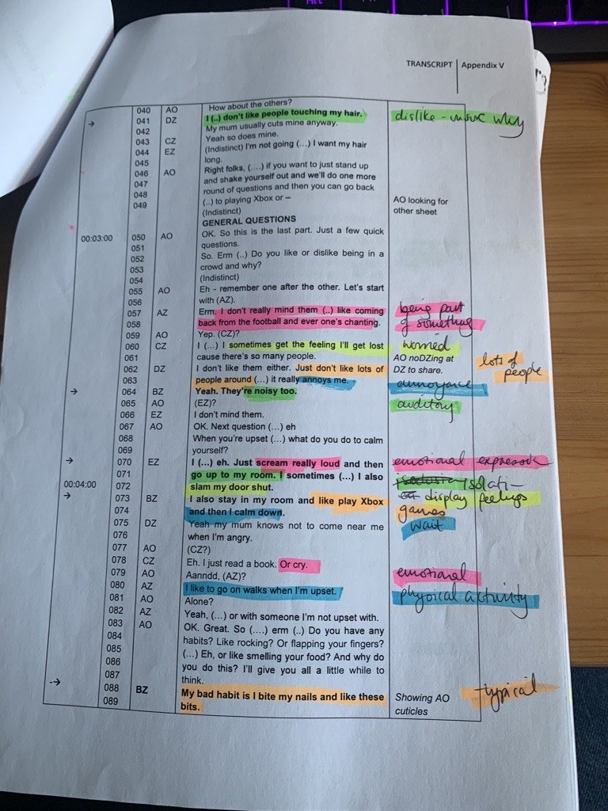
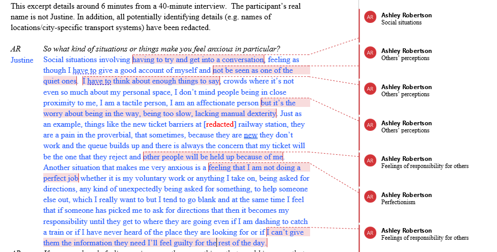

# Data analysis {#ch4_data_analysis}
 
This chapter has activities to support you with Thematic Analysis. This chapter, alongside Ashley's lectures, will talk you through the six phases required for TA; we advise using Braun & Clarke (2021) to structure your data analysis. [This can be accessed through the library](https://go.exlibris.link/Z9qxllzH){target="_blank"}. 

**Overview of the steps of TA**

  1. Familiarisation (p.42 in the Braun & Clarke (2021) book)
  2. Doing coding (p.59)
  3. Generating initial themes (p.78)
  4. Developing and Reviewing themes (p.97)
  5. Refining, Defining and Naming themes (p.108)
  6. Writing up your analysis (p.118)

::: {.callout-important}
## Before you start: a key principle

**Themes do not emerge.** It is common to read that themes 'emerged' from the data. This suggests that themes are lying in wait for you to discover them, and that any analyst would find the same ones. This is not the case: you actively develop your themes, and your experiences, assumptions and interpretations will affect the themes you end up with. This is why reflexivity matters throughout your analysis, not just at the end (see [Chapter 5](05_Ethics_rigour_reflexivity.qmd)).

:::


## Coding (Phases 1-2)

Here, we'll focus on Phases 1 and 2 of the process. We also covered how to do Phases 1 and 2 of the analysis in the Thematic Analysis lecture in Semester 1.

### Phase 1: Familiarisation (p.42)

- Transcribing (or correcting/anonymising your transcript) helps you to become more familiar with your data. You will not do this in this project, but you might during your dissertation. 
- Read over the transcript, but do it in an 'active' way. This means reading while searching for meanings and patterns 
- Note down anything of interest that comes up, either in a particular part of a transcript or thinking about the overall dataset.

::: {.callout-warning icon=false}
## Practical Steps
Read through your transcript and take notes and/or make comments in the margins. Generate a list of ideas: what is interesting about the discussion? Are there any contradictions that you spot? What patterns do you observe?

Also note your own responses to the data (e.g. how do you feel when you read it?), and try to unpick the assumptions behind them:

  * What was familiar?
  * What was unfamiliar/surprising?
  * Why are you reacting to the data in that way?
:::

### Phase 2: Coding (p.59)

  * Codes identify a feature of the data that seems interesting or relevant to your research question
  * The process of coding involves going through the transcript and thinking about the data, and picking out what seems interesting/important.
  * Try to apply short, specific labels to each part of the transcript as you go through it.
  * Codes are specific, and each one usually captures a single idea (themes, which come later, are broader and capture a pattern of shared meaning) – you will likely end up with quite a lot of different codes.
  * Code as much of the relevant data as you can at this point – not every code will make it to the next stage, but it's good to capture as much as you can now.
  

::: {.callout-warning icon=false}
## Practical Steps
Insert labels beside quotes – what is interesting about the quote? What does it tell us in relation to your research question?
:::

### Semantic and latent codes

When you code, you can work at different levels of meaning:

  * *Semantic* codes capture meaning that is explicitly expressed. They stay close to the participants' own words and the surface meaning of the data. Semantic coding still goes beyond summarising or paraphrasing.
  * *Latent* codes capture deeper, more implicit meaning: the underlying ideas, assumptions and concepts behind what is said.

Semantic and latent are two ends of a continuum rather than a strict choice, and many analyses include both. You can see both levels in Braun & Clarke's notes on the Andreas extract in the [optional research skills session](appendix_b_research_skills.qmd#reflexivity_skills_session) (Appendix B): their first notes stay close to what he says, and they then look 'a bit more deeply' at what might lie underneath.

Two related ideas are easy to mix up with semantic and latent:

  * **Inductive and deductive coding** is about where your codes come from: the data itself (more inductive) or existing theory you bring to it (more deductive).
  * **The type of knowledge your study aims to produce** (see [Chapter 1](01_Qualitative_designs.qmd)) is also separate: a realist study can include latent codes, and a social constructionist study can include semantic ones.
  
#### What do Braun & Clarke say about semantic and latent codes?
If you want to explore this in more detail, Braun & Clarke talk about the differences between semantic and latent coding, and provide examples of descriptive and analytical coding, in [Braun and Clarke (2013)](https://go.exlibris.link/wq9gqMKY){target="_blank"} p207-210 and also p252-254.

### How to actually do the coding (logistically)?

There are many different ways to approach this. Below are two examples of how you might approach it: hand-coding and using comments on Word.

Option 1: Hand-coding
```{r img-handcoded, echo=FALSE, fig.cap="Example of a hand-coded transcript"}

```

Option 2: Code using Word, by adding comments
```{r img-commentcoded, echo=FALSE, fig.cap="Example of a transcript coded using comments on Microsoft Word"}

```

If you do a qualitative project for your dissertation, lots of other options will be open to you, so please do ask your supervisor what might be best!

### Activities

#### Activity 1: Example of coding

Have a look at [this example of coding (using Thematic Analysis) from Braun & Clarke (2013)](https://gla-my.sharepoint.com/:w:/g/personal/ashley_robertson_glasgow_ac_uk/IQDRd3yWlsMiSblZD_o1TlT3AZTRrH579OK7FpWr8P6cqMA?e=zP84Cb){target="_blank"}

Think about the following:

Do you agree/disagree with the codes that the authors have chosen? Which ones, and why? Are there any additional codes that you think might be worthy of consideration?

#### Activity 2: Try it yourself!

It's time to have a go at coding yourself now!

Read through [this transcript](https://gla-my.sharepoint.com/:w:/g/personal/ashley_robertson_glasgow_ac_uk/IQAR4YGzxwAwSbiR5O3tsjLWAW9XXSTAk3JAL6F6VwdFGBQ?e=GbusZq){target="_blank"}, taking brief notes individually the first time you read it. What things did you pick up?

A possible research question for this transcript is: *How do students make sense of why people get tattoos and piercings?*

::: {.callout-note icon=false}
## Check your codes before you post

  * Is each code a short label, rather than a summary of what the participant said?
  * Does each code capture one idea?
  * Is each code relevant to the research question?
  * Are all of your codes semantic? If so, read the transcript again and look for anything less explicit. You do not need both kinds, but you should notice which approach you are using.
:::

Identify codes for this transcript and [post them on the padlet](https://padlet.com/ashleyrobertson3/coding-activity-for-rm2-odl-76lzunt0l2p5x0ma){target="_blank"}. Ashley will then give class-wide feedback on the codes to the class. 


## Developing themes (Phases 3-6)

Here, we'll focus on Phases 3 to 6 of the process. We also covered how to do Phase 3 in the Thematic Analysis lectures in Semester 1. For these activities, you are welcome to do them individually or in pairs/small groups – whichever you prefer!


### Phase 3: Generating initial themes (p.78)

In this stage, you should sort the codes into potential themes. Here, you will start to analyse your codes, and consider how they might share an idea or concept.

It might be helpful to visualise this in some way, and see how the codes fit together. You may have codes that don’t seem to fit anywhere, others will fit neatly into themes, others might be in sub-themes.

You end this step with a collection of candidate themes (and potentially sub-themes).

::: {.callout-warning icon=false}
## Practical Steps
  * Start to group your initial codes together
  * Can you see a pattern of shared meaning across different codes?
  * What are the similarities across codes?
  * End this stage by collating all the coded quotes relevant to each theme.
  * Themes can be descriptive or interpretative (see Braun & Clarke, 2013, Ch 11). 
  * Using tables or mind maps at this stage can be helpful
:::

  
### Phase 4: Developing and Reviewing themes (p.97)

In Phase 4, you check your themes to see whether they make sense a) when you look at the coded extracts for that theme and b) when you look at the whole dataset.

*Checking the coded extracts*

Reviewing at the level of the coded extracts. Read all the collated extracts for a theme…do they form a coherent pattern? Do they tell an important story about shared meaning? Are you sure they are themes rather than topic summaries? 

If they seem like themes and the coded extracts fit well underneath them, then move on to checking the themes against the dataset.

If they don’t, is it the case that a) the theme itself is problematic and needs to be reworked or b) the theme is fine, but some of the data doesn’t fit?

*Checking themes against the whole dataset*

Look across the entire dataset and consider your theme(s) – do they accurately reflect the meanings in the dataset? Do they tell you about the important patterns that you observed in the dataset?

::: {.callout-warning icon=false}
## Practical Steps
  * It may be necessary to collapse two themes together, to split a theme into two or more themes, or to discard the candidate themes altogether and begin theme development again.
  * Not every participant will make specific reference to every theme – that is ok – but think about how each person is represented in the analysis.
:::


### Phase 5: Refining, Defining and Naming Themes (p.108)

  * During this phase, you should define and refine the themes.
  * Define and refine = identifying what this theme is about, what aspect of the data is captured by each theme?
  * For each theme, you need to conduct and write a detailed analysis
  * Do your themes explain different things without overlapping too much?
  * Try to choose names for themes that are not one word or likely to indicate topic summaries (see the Semester 1 Thematic Analysis Lectures if you want to revisit this)

::: {.callout-warning icon=false}
## Practical Steps
 * This involves being able to explain each theme: 'What story does this theme tell?’ and ‘how does this theme fit into the overall story about the data?’.
  * Identify the ‘essence’ of each theme and construct a concise, punchy and informative name.
:::

  
### Phase 6: Writing up your Analysis (p.118)

  * The analysis should provide a concise, coherent, logical, non-repetitive and interesting account
  * The write up must provide sufficient evidence of the theme(s) (this is where the quotes come in!)
  * The extracts you choose should clearly illustrate the theme
  * Writing up is where you build your narrative around the themes and quotes – see [Developing a narrative](#developing-a-narrative) below for guidance

::: {.callout-warning icon=false}
## Practical Steps
  * For the RM2 qualitative report, you should report either two themes (no sub-themes) or one theme with 2-3 sub-themes. This is to allow you to balance depth and breadth due to the limited word count.
  * Try to include some 'longer' quotes for each theme, and avoid using lots of very short quotes. This will allow you to explore in more depth. You can supplement longer quotes with some shorter quotes.
  * Try to remember that the reader (or marker) needs to see evidence of your ideas - the quotes are your evidence.
:::

### Activities

#### Activity 1: Try it yourself!

Use the same transcript as for Phases 1-2 – [it is linked here](https://gla-my.sharepoint.com/:w:/g/personal/ashley_robertson_glasgow_ac_uk/IQAR4YGzxwAwSbiR5O3tsjLWAW9XXSTAk3JAL6F6VwdFGBQ?e=GbusZq){target="_blank"}. You can use the codes you developed in the coding activity, or you can recode the data again if you prefer – either option is fine.

  * Once you have your codes, try to organise them into themes.
  * Group together the codes that seem similar in some way – can you think of an overarching 'theme' that describes them? 
  * Are there any codes that don't 'fit' anywhere? (that's okay if so!)
  * Can you identify any quotes that you would use to evidence the themes? Do these definitely match well onto the theme?

::: {.callout-note icon=false}
## Check your themes

There is no single correct set of themes for this transcript, so use these questions to review your own:

  * Does each theme capture a pattern of shared meaning, rather than a topic summary (a collection of everything participants said about one topic)?
  * Can you explain what each theme is about in one or two sentences?
  * Is each theme's name more than one word, and does it tell the reader something about what you found?
  * Do the coded extracts under each theme fit together? Are there any that belong somewhere else?
  * Do your themes overlap too much? Or are they so unrelated that they do not tell one story about the data?
  * Does each theme help to answer the research question?
  * Are any of your themes really just the interview questions?

If any of these questions shows a problem, go back to Phase 4. See also [Some common problems with thematic analysis](appendix_b_research_skills.qmd#skills_data_analysis_common_problems) in Appendix B.
:::

::: {.callout-caution icon=false collapse="true"}
## One possible set of themes

Try the activity and the self-check first. This is one possible analysis of the transcript, not the correct answer: another analyst could develop different themes from the same data, and that would be fine if their themes were well evidenced. These themes are very tentative as they are based on a small excerpt. In a full study, you would need to develop your themes across the whole dataset.

**Theme 1: 'They're gonna be there for rest of my life': tattoos need to mean something**

Participants presented personal meaning as the main reason for getting a tattoo. The meanings were not consistent from participant to participant: a tattoo might mark a relationship (Rachel's example of a celebrity with her children's birthdays tattooed on her wrist), identity (Mandy had her name in Japanese), stages of personal growth (Jo talked about how her tattoo related to sprituality) or a way of coping (Thomas's 'carpe diem' tattoo). These accounts share the idea that a tattoo has to be *justified*, which is likely related to its permanence. Mandy makes this link herself by saying that they have to 'mean something' to her, as they will be there for the rest of her life.

Piercings were discussed far less. Jo provides an interesting contrast: her tattoos represented spirituality for her, whereas her piercings were 'purely' for sexual gratification. One tentative interpretation is that because piercings can be removed, they might not be held to the same standard of meaning as tattoos.

**Theme 2: 'You can't stop me': body modification as a claim to independence**

Several participants linked tattoos and piercings to defiance (especially of parents). This was related to reaching an age where parents could no longer prevent it: David compared it to going to the pub on your eighteenth birthday because you can, and Rachel's sister got her belly button pierced once she turned 16 and told her parents 'you can't stop me'. However, this was not consistent throughout the transcript - although rebellion was not the reason for Thomas's tattoo, he did say that telling his mother 'felt great'. However, claiming independence does not necessarily end parental disapproval: Jo’s mother still reacted strongly when she saw Jo’s tattoo.

**What these themes leave out**

These themes take participants' accounts largely at face value, focusing on the reasons and meanings they describe. A researcher aiming for social constructionist knowledge (see [Chapter 1](01_Qualitative_designs.qmd)) might focus on how the group talked instead: for example, how participants' stories about defying their parents, and the laughter that followed them, present parental disapproval as normal and funny.
:::

::: {.callout-caution icon=false collapse="true"}
## Show how these themes were reviewed (Phase 4)

The first set of candidate themes looked different. Three changes were made during review:

  * **'Reasons for getting tattoos and piercings' was dropped.** It grouped everything participants said in answer to the moderator's question, so it was really the interview question rather than a theme. It collected data on one topic but did not identify a shared meaning, which makes it a topic summary.
  * **'The thrill of getting a tattoo' was merged into Theme 2.** Only Thomas described this, and the thrill he describes comes from telling his mother, so it fits better within the theme about independence from parents.
  * **'Piercings for sexual gratification' did not become a theme.** It came from one participant in one line, so there was no pattern. Rather than discarding it, it was used as a contrast within Theme 1, because it helps to show what makes tattoos different.

Codes that do not fit any theme are normal. Remember that every code does not need to make it into your analysis.
:::

#### Activity 2: Bad analysis

This is an additional activity and only if you have time/want to explore a bit further. [Have a look at the analysis](https://gla-my.sharepoint.com/:w:/g/personal/ashley_robertson_glasgow_ac_uk/IQBxa8y9s23wQow1Hj-j8tzFAd6f1kteRslWF7q_N8I7mFE?e=Ww3ka4){target="_blank"}. This is an example from Braun & Clarke's book. Why do you think it might be considered a poor example of thematic analysis?

After you've finished, you can look at [the points that Braun & Clarke identified](https://gla-my.sharepoint.com/:w:/g/personal/ashley_robertson_glasgow_ac_uk/IQDXnfPn2FVqTq4-bxWPdoMkAdInkV-wRlIWc7a3QOWrlYc?e=5D51jh){target="_blank"}. Did you identify any additional ones? Were there any you missed?

## Developing a narrative

When doing your thematic analysis, it is important to develop a narrative and go beyond paraphrasing/summarising your data.

Thematic Analysis requires an active approach from an analyst. It is your role to make sense of the data and to present this in a coherent, understandable and accessible way to the reader. You will take these 'patterns of meaning' and make sense of/interpret them, and convey these to the reader. Remember that themes do not emerge (see the start of this chapter): the narrative is something you build, and it reflects your interpretation of the data.

When you present your data in the analysis section, you will have a) your list of themes and b) your quotes. It is your job to combine these with analytical commentary, in order to tell the story of your data. It's not enough to present the themes and then back these up with quotes – your job is to add in a narrative that brings the themes and the evidence (i.e. quotes) together.

**Things to be aware of in developing a narrative**

1. Remember to introduce your theme to the reader – what is it about? Don’t start a theme with a quote. If you have sub-themes, still introduce the overall theme briefly before you discuss your first sub-theme
2. Explain to the reader why you’ve chosen to include each quote. Why is it important enough to be included? What does it tell us about your data?
3. Focus on depth rather than breadth – it is important that we get a real sense of your theme. In the RM2 report you only have 3000 words in total, and so will have to choose what you discuss
4. Show the reader who each quote comes from – we should be able to match this up with the demographics table/list of interviews in the Methods section (which then gives us some context). You can do this by using pseudonyms and linking this to the table by using the same names there too.
5. Think about where the opportunities are in your data to go beyond description. Is there anything you can infer? If so, remember to be clear with the reader that this is your interpretation. Your reader should be able to see why you have interpreted the data this way from the quotes you've chosen.

### Activities

#### Activity 1: Analysing vs. summarising
Read pages 8-12 from [this thematic analysis](https://study.sagepub.com/sites/default/files/anderson_clarke_reflective_commentary.pdf){target="_blank"} on skin-picking. Here, the authors report three themes and then have a reflection at the bottom. Try to identify where the authors have gone beyond paraphrasing – discuss in your groups/pairs if you can.

#### Activity 2: Evaluating analysis and discussion sections
Do [this exercise](https://gla-my.sharepoint.com/:w:/g/personal/ashley_robertson_glasgow_ac_uk/IQBIisCoHaq9QrC3jscuTuNpARjS8Zm3Xk6gDRUbtHGj3AQ?e=fvQoYl){target="_blank"} on evaluating analysis sections of published papers.

If you are planning a qualitative dissertation, the [optional research skills session](appendix_b_research_skills.qmd#reflexivity_skills_session) in Appendix B goes into reflexivity, familiarisation and common problems with thematic analysis in more depth.
