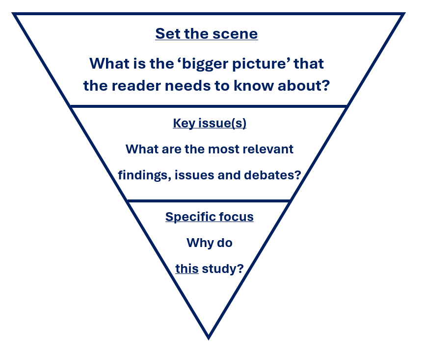
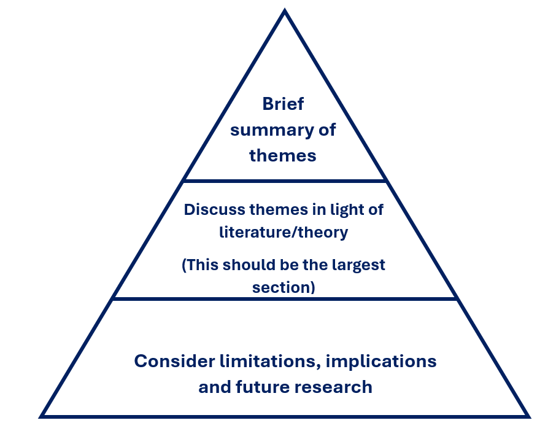

# Qualitative report {#ch8_qualitative_report}

In this section, you will find information and guidance about your qualitative report and a report writing guide. Please make sure to familiarise yourself with the Assessment Information (provided in the Assessment section on Moodle) before starting to work on the report. We have also provided a [suggested timeline](https://gla-my.sharepoint.com/:w:/g/personal/ashley_robertson_glasgow_ac_uk/IQADNhc7ItBSQJQykyV4Iu_vAa5uyEyAcObWtzGl0og2X64?e=1sbP7r){target="_blank"} for the qualitative report and portfolio.

For this assignment, you will be asked to write an individual qualitative report on one of five secondary data topics. You should conduct Thematic Analysis on your chosen dataset. A video on the Qualitative report will be provided on Moodle – please make sure to watch this. We provide guidelines on the report [later in this chapter](#qual_report_guide).

## Report datasets and how to use UK Data Service

Before accessing your datasets, watch [this video](https://echo360.org.uk/media/ac815f47-bb97-40cc-8c34-d82d74e4bb0e/public){target="_blank"} on how to use UK Data Service. It shows you an example of how to download the data with one of the datasets. Please note that some of the datasets are on sensitive topics, and contain information that may be upsetting: make sure to familiarise yourself with the interview schedules and have a quick scan of the data before you decide which dataset to work with. 

[The UK Data Service can be accessed here](https://beta.ukdataservice.ac.uk/myaccount/login){target="_blank"}

You can choose one of the five available datasets: 
  
  1. [Interviews with disabled young people and carers](https://datacatalogue.ukdataservice.ac.uk/studies/study/854556?type=reshare#details){target="_blank"}
  2. [LGBT+ networks in the workplace](https://datacatalogue.ukdataservice.ac.uk/studies/study/855322?type=reshare#details){target="_blank"}
  3. [Long-term relationships](https://datacatalogue.ukdataservice.ac.uk/studies/study/851244?type=reshare#details){target="_blank"}
  4. [Patient descriptions of PMS](https://datacatalogue.ukdataservice.ac.uk/studies/study/855486?type=reshare#details){target="_blank"}
  5. [Student experiences of loneliness and social connectedness](https://datacatalogue.ukdataservice.ac.uk/studies/study/856114?type=reshare#details){target="_blank"}
 
Please note that some of the datasets may include pre-existing coding in the data folder, or published analyses; you should **not** use these, as this will count as academic misconduct; you are expected to develop the full analysis yourself. 

## Developing a research question

As part of writing up your qualitative report, we ask that you develop a research question (RQ) to help you guide your enquiry. Below, we have some guidance on how to get started. 

### Getting started with the data

For this report, you are using secondary data. This means that the data have already been collected – before you start thinking about your research question, have a look at the interviews to see what was asked in the interviews. Usually, most interviews are semi-structured. This means that there are likely to be some questions asked consistently, but there will also be differences, depending on the responses by the participants. 

Looking at the data before you decide on your RQ might feel a bit strange after RM1, but remember that you are not doing hypothesis-testing with qualitative designs – it is quite normal for a qualitative research question to change during the research process, and this is completely fine as you are not statistically testing for a specific effect.

Be mindful that you are not making a research question that is actually one of the interview questions – your RQ should be broader than an interview question.

One of the most common mistakes that students make when framing their research question in RM2 is that it is a little too 'quant' in nature. This makes perfect sense, as most of your research methods education so far in the programme has been focused on quant! However, for your qual report, your RQ should be a little different to the RQs you are used to. 

Look at the following examples:

1. How does poor sleep impact on wellbeing? 
2. What is the difference in wellbeing between those who belong to university and those who don't?

Both questions are a bit too quantitative in nature (i.e. 1 is causal and 2 is about a difference between groups). They would also benefit from thinking about what is being looked at, specifically (e.g. views, opinions, experiences).

We'd perhaps rephrase these as follows:

1.  What are students' perceptions of the relationship between sleep and wellbeing?
2. What are online conversion students' experiences of belonging to university? How do these experiences relate to perceived wellbeing?

These questions are now a bit more in line with qualitative and are specific about what they are asking in each (and also what the group of interest is). The second one covers a bit more than the first, which is why it is split into two (a main RQ and a subsidiary one).

### Some tips for developing a research question

  * **Communication:** Keep your research question simple and specific. If you have a very broad question, it can be helpful to break the question down into smaller sub-questions.
  * **Type of question:** Think about the type of knowledge you want (see [Chapter 1](01_Qualitative_designs.qmd)): what happened, what someone's experience was, or how a situation was described. Ask about experiences, views, understandings or accounts, and avoid questions about causes or differences between groups. Your RQ should also leave room to interpret what participants say, not only to describe it.
  * **Practical constraints:** Can the question realistically be explored using thematic analysis and using secondary data? Try not to cover too much.
  * **Guiding:** Remember that your RQ guides your enquiry but shouldn't be restrictive – it's not the case that you are unable to report themes that don't directly answer your RQ. 
  * **Flexibility:** Research questions are more flexible than hypotheses – it is acceptable for the focus of the RQ to be refined during analysis.
  
### Formative feedback on your RQ

If you would like to receive formative feedback on your RQ, you can submit it on [this Padlet](https://padlet.com/wilhelmiinatoivo/rm2-odl-research-questions-f844153314j3pwr2){target="_blank"} by the end of Semester 2 Week 5. Please note that RQs submitted later than that will not receive feedback, and you would need to drop into office hours instead.

If you would like to discuss your RQ, you can also attend Ashley's and Wil's office hours.

### Choosing your interviews

Once you have developed your research question, you should choose the interviews you are going to analyse for the report. Some of the datasets are really big and involve multiple components (see the qualitative report video for further guidance on the datasets).

  * **You should use a maximum of 2–3 interviews (or focus groups) for your analysis**
  * If you are working with the couples dataset, you can do 4 interviews if you want to do two couples
  * If you are working with the couples dataset, do not use the collage interviews
  * If you are working with the LGBT dataset, only use interview data for your report
  * If you are working with the PMS dataset, only use patients' interviews (the expert interviews do not lend themselves to the type of qualitative analysis we ask you to do)
  * If you work with the student loneliness dataset, only use the focus group data
 
There is no one protocol for choosing your interviews. Sometimes you may choose depending on which interviews have the most/richest data about your specific RQ (as the datasets are suited for a large number of different RQs), or in other cases you may choose the interviews based on particular demographics (if this is a part of your RQ, for example, looking specifically at carers', mothers', or men's perspectives). We recommend scanning through multiple interviews to gauge which ones might work best for your particular RQ (do not summarise them with AI – the datasets are from real research participants and should not be uploaded to any AI platforms). You will be asked to report your data selection process in the Method section of your report.  

## Qualitative report guide {#qual_report_guide}

This guide is intended to help you in the write up of your qualitative project report. When writing your report, remember to use the other resources available to you:

  * Your feedback for your RM1 report
  * Chapter 13 in [Braun & Clarke (2013)](https://go.exlibris.link/5g3nFfGx){target="_blank"} is excellent support for writing up qualitative research
  * [Braun & Clarke (2021) book](https://go.exlibris.link/Z9qxllzH){target="_blank"}
  * All the resources available in this book (particularly [Chapter 4: Data analysis](04_Data_analysis.qmd) and [Chapter 7: Academic writing](07_Academic_writing.qmd))
  * **Reading list:** [Published articles that use a Thematic Analysis](https://rl.talis.com/3/glasgow/lists/30BEDB96-5F9D-9F9E-630A-205B91FA34AB.html?lang=en-GB#B226C8C1-1926-8328-A8A3-06DC389D9809){target="_blank"}
  * [A helpful resource for APA formatting is OWL Purdue](https://owl.purdue.edu/owl/research_and_citation/apa_style/apa_formatting_and_style_guide/general_format.html)
  
Use the assessment criteria (in the Assessment Information on Moodle) as a checklist before you submit the report, to ensure you have addressed all points. If you have questions, post on Teams and/or visit our office hours.  All the best in writing your report.

### Required Submissions

Two separate submissions are required for this report: 

- **Submission 1** should contain the report itself, along with the specified sections and appendices. 
    - Cover page with title (does not count towards the word limit)
    - Abstract
    - Introduction
    - Method
    - Analysis
    - Discussion
    - References (does not count towards word limit)
    - Appendices (does not count towards word limit)
   
    
- **Submission 2** should contain the required information about the process of your analysis, using the template provided. Submission 2 does not count towards the word limit. Please note that Phase 6 is not included, as this is what you include in your Analysis section.
    - Phase 1 (Familiarisation)
    - Phase 2 (Coding)
    - Phase 3 (Generating Initial Themes)
    - Phase 4 (Developing and Reviewing Themes)
    - Phase 5 (Refining, Defining and Naming Themes)
    - Your coded transcripts


### Submission 1: The Qualitative Report

#### General writing style

- Your writing should be clear, concise and easy to follow – remember that academic writing does not need to be complicated to be good. One tip is to [use Word to read your report back to you](https://support.microsoft.com/en-gb/office/listen-to-your-word-documents-5a2de7f3-1ef4-4795-b24e-64fc2731b001){target="_blank"} – sometimes it’s easier to hear where a point may be overly complex or long and where you might want to cut it down.

- Maintain a neutral, academic tone throughout. Avoid a ‘journalistic’ tone, where you convince the reader based on using emotive language. Instead, show the reader why you think the way you do and the evidence base that underlies this.

- Discuss one idea/argument per paragraph. An excellent resource to help with this is the [reverse outline](https://explorationsofstyle.com/2011/02/09/reverse-outlines/){target="_blank"}.

- You should format your headings, in-text citations and references in APA 7th style. 
- APA writing style encourages the use of active voice (“I coded the data” rather than “the data were coded”) but if you feel more comfortable writing in passive voice, feel free to do so – just make sure to be consistent throughout and be careful not to make your writing overly complex.

- Tenses are not always fixed per se (as it depends on how a sentence is structured). However, generally, the following applies – past tense should be used when you have done something already (like your study). For example, we would usually see past tense in the Methods (unless doing a registered report) and the Analysis section. When talking about papers that are already published (in the Intro and Discussion), again these would typically be in past tense. 

- You can use first person singular (I) or plural (we) in the report itself if you want to, but in the reflexivity section make sure to write in first person singular. This is because this is your reflection of your own positionality to the RQ and the data, and it’s often very personal.


#### Title

The title should be included as part of the cover page. It should reflect the research question(s) and define your sample (e.g., undergraduate students' experiences of…). Try to be specific – your title should include: 

  * Who
  * What 
  * How 

**Examples:**

  * A Thematic Analysis *(how)* of the panic attack experiences *(what)* of primary aged children in inner city schools in the UK *(who)*
  * Barriers and enablers to modifying sleep behaviour *(what)* in adolescents and young adults *(who)*: A qualitative investigation *(how)*

#### Abstract (suggested word count: 100–150 words)

In an academic journal, the function of an abstract is to give readers a snapshot of the whole paper. They then use this to decide whether or not to read the full article. Therefore, you should make sure you cover all four main sections of your report, summarising them all succinctly.

Aim to summarise all sections of the report in 100–150 words, including: 1) what does the existing literature tell us about the topic 2) aim of the study 3) brief methodology, 4) approach to analysis, 5) main findings, and 6) key aspects of the discussion. Keep in mind that you are summarising your research for a non-expert and you want to “entice” them to read more.

::: {.callout-warning icon=false}
## Tips
- Start out by writing four sentences, each summarising one section of the report (introduction, methods, analysis, discussion). Now, look at the six sections above and see where you might need to add a bit of detail.
- One common mistake is to ignore the discussion, saying something like 'Findings are discussed in relation to existing research'. This doesn't tell us anything about what your overarching thoughts are about your findings and how they relate to the literature base.
:::

#### Introduction (suggested word count: 700–800 words)

Some activities to support you with writing your Introduction can be found in [Chapter 7](07_Academic_writing.qmd#eval_intro).

The introduction should give readers enough background to understand your rationale for further research, whether your study is qualitative or quantitative. Provide a clear, critical review of the most relevant published research and highlight the key issues and debates in the field. Use these to build a logical argument for your study.

Follow the APA-style funnel structure: begin with a broad overview of the topic, then narrow the focus until you reach your specific rationale and research question(s).

Because your word count is limited, focus on recent and directly relevant studies, especially the latest qualitative research in this specific area. Show how your project builds on the most recent work to strengthen your rationale. Remember to cite all sources used, including government reports, websites, and media items.

A resource for helping you to develop evaluation in your introductions can be found at the start of [Chapter 7](07_Academic_writing.qmd).

```{r img-intro, echo=FALSE, fig.cap="Broad-to-narrow structure of an introduction"}

```
You should end with a statement of what the aim of your study was, and the research question.


When reviewing previous studies, don't just describe them – evaluate them. Highlight their limitations, but only those your study can realistically address. Consider what the findings mean, note any conflicting results, and think about why they differ. This should naturally build toward a clear rationale for your own study.

Then, explain your study and clearly state your research question(s), ensuring they connect directly to the issues raised in your introduction.

In summary:

- Review and critically evaluate relevant theories and research.
- Justify your study by linking gaps or limitations in past work to your research questions.
- Clearly outline your main and subsidiary research questions, ensuring these are phrased in a way that aligns with a qualitative approach.

Remember: just like in a quantitative report, this section shows what has been done before and why your study is needed.

::: {.callout-warning icon=false}
## Tips
- In your rationale, remember to tell the reader why the current study (i.e. the topic and group of participants) is **important**. 
- If identifying limitations of existing research, make sure to pick something that you are able to address in your study. If you say that one issue is that heart rate wasn't gathered, but you don't do this in your study, this can be confusing for a reader.

:::

#### Method (suggested word count: 350–450 words)

The aim of the method section is to clearly report how your study was conducted – the reader should be able to re-run your research from the details provided. In this case, contextualise the original study that your secondary data are from, report details of the original data collection, explain your process of refining and selecting the data used for your project, and describe the qualitative analysis you used. True ‘replication’ is difficult due to the central role of the researcher in influencing some aspects of the research such as analysis. This is not an experiment.

Follow these subheadings for your method section for this report:

**Secondary data**

In this section you should describe the original study and give the reader context about their data collection. Understanding the specific context of each study is a key element of qualitative research, which is why it is really important for you to explain that in order for your secondary analysis to be reported openly.

What was the original study about? Who conducted it? Where are the data available? You should cite your chosen dataset in APA style (do not provide a link in text) – each dataset has this information on the UK Data Service page under the Citation and copyright section. How many interviews did they conduct, what was the methodology they used for the interviews (you should find this information on the UK Data Service page for your chosen data set)? Who were their participants? What were the participants asked about?

If you have demographic information about the participants on the UK Data Service Website, you may wish to include this, but don’t worry if your chosen dataset doesn’t provide this – we don’t expect you to report any information that was not available to you.

**Data selection**

In this section you should describe your procedure for choosing your final data set. How many interviews did you choose? How did you choose the specific ones you decided to use for your analysis?

**Ethics**

The information you are able to provide in this section will depend on the information made available within the dataset. Some things you might want to comment on include: anonymisation procedures (e.g. has information been replaced or redacted), rapport building, information/consent/debrief, consent as a process. You will only be able to include information that has been made available in the dataset, so do not worry if you do not know a lot of detail.

You could also comment on how you handled the data yourself, for example by following the UK Data Service's conditions for using the data and not putting the data into generative AI tools.

**Reflexivity**

In qualitative research it is important to acknowledge the role of the researcher in interpretation of the data [(Elliott et al., 1999)](https://bpspsychub.onlinelibrary.wiley.com/doi/10.1348/014466599162782){target="_blank"}. 

In this section, you evaluate how you shaped the research process. Start briefly with your position: what motivated you to choose this dataset (apart from us telling you to do the project), and what assumptions or experiences did you bring to the topic? Then focus on how these affected the decisions you made. For example, did they affect which interviews you chose, what you noticed and coded, or how you developed and named your themes? Did anything in the data surprise you or challenge your assumptions, and what did you do about it? Different researchers would interpret the same data differently. Your subjectivity is part of the analysis, so show the reader how it shaped your decisions.

See Braun & Clarke (2013, pp. 36–37, 303–304) and the [reflexivity activities in Chapter 5](05_Ethics_rigour_reflexivity.qmd#ch5_reflexivity). Activity 3 (Section 2: Your position in relation to your dataset) is about working with data that someone else collected. Reflexive analysis should be concise for this project, perhaps around 3–4 sentences. However, you will also have to include a reflexivity diary as a part of your appendices.

**Data Analysis**

In this section, explain:

- What analysis method you used and your theoretical approach: the type of knowledge you aimed to produce (realist, phenomenological or social constructionist). See [Chapter 1](01_Qualitative_designs.qmd), Activity 3: Thinking about theory, for a reminder.
- The stages of your qualitative analysis. Be clear and specific – qualitative work is sometimes criticised for being vague. Use recognised guidelines (e.g., Braun & Clarke for Reflexive Thematic Analysis).

When outlining the stages:

- Give a brief summary of the full process, linked to the relevant framework (e.g., RTA). Around three to four sentences total is enough for this length of report.
- You can keep some phases short (e.g., “familiarisation with the data (Phase 1); generating codes (Phase 2)…”).
- Aim for transparency – explain what happens between coding and theme development.
- Describe the researcher as actively developing themes, not waiting for themes to “emerge,” which incorrectly suggests they are already there waiting to be found.

::: {.callout-warning icon=false}

## Tips

- In the methods section, try to be precise and succinct in your writing (this applies to the whole report, but is particularly important here). Think about what the reader needs to know and how to best communicate this.
- Common errors include inaccurate information (e.g. the wrong number of phases in Braun & Clarke’s framework) and a superficial reflexivity section.

:::
  
#### Analysis (suggested word count: 750–850 words)

Some activities to support you with writing your Analysis section can be found in [Chapter 7](07_Academic_writing.qmd#eval_analysis).

The analysis section is where you present the evidence you’ve collected. It works like a Results section in a quantitative report.

Your goal is to make the analysis transparent, showing clearly how your interpretations come from the transcripts. Use extracts from the transcripts to support your interpretations. 

Please note that some of the datasets include pre-existing coding; you should **not** use these, as this will count as academic misconduct; you are expected to develop the full analysis yourself through the six phases.

**Guidelines**

- Report either two themes (no sub-themes) or one theme with 2–3 sub-themes in the Analysis section, even if you found more. You will not be able to go into enough depth if you present more themes than this, due to the word count restrictions. 
- If you want to use parts of a quote, rather than the full quote (e.g. maybe you want to remove the middle sentence, which doesn’t add anything), you can indicate you omitted something with ellipses. 
- Never alter any of the words or phrasing that is used, even if you think you know what the participant was going to say. This would be as unacceptable as editing numbers in a quantitative analysis! 
- Try to strike a balance between quotes and interpretation. We sometimes see lots of quotes with very little analysis or lots of analysis with very few quotes, both of which have problems.
- **Do not** include citations in the analysis section of this report. Sometimes in published qualitative papers this is done, but due to the limited word count, we ask you to not do it for this assignment. Here, you should connect your research into existing literature in the discussion section.

::: {.callout-important}

## Generative AI and data

Do not, **under any circumstances**, put the transcripts or quotes from the transcripts into generative AI (this includes Copilot). This will not have been agreed as part of the original ethics and participants will not have consented for this use of the data. 

Failing to follow these instructions puts you at risk of academic and research misconduct. 

:::

**Structuring the Analysis section**

- Start with a short paragraph summarising the main themes **without** using any quotes. This should not be too long – perhaps around a sentence or two.
- If you have two themes:
    - Present each theme using a sub-heading
    - Give the reader a brief overview of what the theme is. It is likely that you will have to select a few key points that encapsulate your theme, rather than describe everything in your theme in detail. For a dissertation, where you have more available word count, you will be able to cover more.
    - Once you’ve introduced the theme, tell the reader about what you found in your analysis of this theme. Make sure to incorporate quotes to support your analytical points.
- If you have one theme and 2–3 sub-themes:
    - Have sub-headings for the overall theme as well as the sub-themes.
    - Briefly explain the overarching theme and then how the sub-themes relate to the larger theme. Do not present quotes at this point.
    - Then, present each of the sub-themes in turn, under sub-headings. In each of these, tell the reader what you found in the analysis of your theme and incorporate quotes to support your analytical points.

**Presenting Quotes**

Use *long quotes* by placing them in a separate, indented block. *Short quotes* can be included within the sentence. Due to the word count, you are likely to be able to do a maximum of one or two longer quotes per theme or sub-theme. 

You can find guidance on presenting participant quotes in APA format [in the recommended resources](https://apastyle.apa.org/style-grammar-guidelines/citations/quoting-participants){target="_blank"}. APA style puts quotes of 40 words or more in a separate block. Forty words is quite long, so we suggest deciding case by case (e.g. a quote of 39 words within a sentence might be correct but might also be confusing to read). You can run anything past us if you are unsure. 

We have also [prepared an example](https://gla-my.sharepoint.com/:w:/g/personal/ashley_robertson_glasgow_ac_uk/EWfG8vjCAvtPjYPEJjQWxl8BPHlfzuI6weVkwIh_MVJSTQ?e=x7OT9m){target="_blank"} of how to format quotes in APA style.

**Going Beyond Paraphrasing**

A strong analysis section will *analyse* the data, going beyond summary and paraphrasing. What do you add, as the analyst? You will have much more knowledge of the data, and it is your job to pass on that insight. If you paraphrase the data, the reader will be able to see this in the quotes, but the analysis then doesn’t add anything extra.

::: {.callout-important}

Instead of telling the reader what was talked about, explain **what the things that were talked about reveal or suggest** about the phenomenon you are studying.

:::

Avoid writing themes that are topic summaries, as these are at a descriptive level. 

- A theme of “Stress and workload” is mainly descriptive. It tells us the topics that participants mentioned, but not why they matter or how they relate.
- A theme of “Stress is an unavoidable requirement of ‘being a good student’” is interpretative. It goes further by explaining what stress *means* for the participants. For example, the data might show that students see stress as tied to their identity as students and that this is something that they expect, rather than something to avoid.

This kind of deeper interpretation goes beyond the superficial to show the reader what the data suggests, rather than just summarising it.

::: {.callout-warning icon=false}

## Tips

- There is no single “correct” interpretation, but you must show clearly how your interpretation is supported by the quotes you use. 
- Go beyond describing the data: explain the underlying meaning. 
- Choose quotes that directly support the point you are making; the connection should be obvious to the reader. 
- Follow the guidelines: include the recommended number of themes/sub-themes, and balance quotations with your interpretation.

:::


#### Discussion (suggested word count: 700–750 words)

Some activities to support you with developing evaluation in your Discussion section can be found in [Chapter 7](07_Academic_writing.qmd#eval_discussion).

The Discussion is where you bring together your findings and consider how they fit with the literature (and theory) and with the wider social and psychological context of your topic. It is also where you consider the wider importance of your findings, reflect on limitations and think about potential implications and future directions. 

**Start with a brief recap**

- Remind the reader of the theme/s you report in the Analysis section and relate these to your Research Question. 

**Connect your findings to past research**

*Note: This should be the largest section within your Discussion.* 

- Here, compare your results with the studies and theories you mentioned in the Introduction, as well as any new studies/theories you want to incorporate. 
  - Say whether your findings support or contradict those from the literature base. However, also go beyond this and tell us what this **means**, more broadly. Why might this be important?
  - Say whether your findings extend/challenge what is already known. If so, tell us what this means/why it is important, and back your points up with evidence. 
  
::: {.callout-important}

## Going beyond 'agreement/disagreement'

It is important to go beyond simple agreement or disagreement, and interpret the data. The following is a 'not so great' example: 

- "Our theme showed that postgraduate students felt a lot of pressure to succeed, but they did not agree on what “success” actually meant. This is similar to Skye (2023) who said that postgraduates think success means getting good grades, although some thought it meant being a good group member or answering questions in class. Therefore, our results match Skye’s findings."

This is a stronger example: 

- “Our theme showed that postgraduate students feel strong pressure to ‘succeed,’ yet they hold different and sometimes conflicting ideas about what success actually means. This supports Skye’s (2023) finding that, while many postgraduates focus on good grades, others define success through group contribution or speaking up in class. Our findings add to this by showing that it is even more complex, as students tend to hold multiple ideas of success at the same time, creating uncertainty about how to meet expectations. This shows that success is not a fixed standard but something students actively negotiate in response to academic norms and peer pressures. This emphasis on negotiation echoes Isla’s (2025) findings that medical staff similarly construct their professional identities in relation to shifting expectations.”

In the second, the author goes into more depth and explains to the reader what the current findings add. They also then explain this by linking (through the observation that negotiation was key) to a relevant finding from a different field. 
:::

**Discuss implications**

- Explain any practical or theoretical implications of your findings. Remember to make these realistic and linked to your findings.
- Try to make these concrete suggestions, rather than vague statements.
- Remember to back these points up with evidence from the literature base.

**Reflect on limitations**

- In this length of report, we suggest picking a maximum of one or two limitations, so that you have the opportunity to develop some depth. 
- Avoid limitations that are more suited to quantitative studies 
  - sample size 
  - lack of generalisability 
- Think about limitations that are *relevant* instead 
  - The kinds of experiences or voices not represented 
  - What the research design prioritised or obscured 
  - How the method of data collection might have shaped interpretation 
- As with the other sections, the limitations section is stronger when you clearly link to the evidence base. 

**Suggest future research**

- Show what you would do differently next time and why. Propose ideas for studies that naturally follow from your findings. 
- Link to the literature base to support your points.

```{r img-discussion, echo=FALSE, fig.cap="Narrow-to-broad structure of a discussion"}

```

::: {.callout-warning icon=false}

## Tips

- Link to evidence in support of the points you are making throughout the whole Discussion section (including limitations, implications and future directions).
- Pick limitations that are relevant to qualitative research.
- It's okay to bring in new literature into the Discussion, but try to also bring back key studies/theories that you introduced earlier on in the report.

:::


#### Recap of word count for each section of the report
  * **Abstract**: 100–150 words
  * **Introduction**: 700–800 words
  * **Method**: 350–450 words
  * **Analysis**: 750–850 words
  * **Discussion**: 700–750 words

The report has a limit of 3000 words in total.

We understand this can feel like a lot to fit into the report, but it’s a good chance to practise writing concisely. It’s okay to go slightly outside these guidelines, but try not to deviate too much.

A common mistake is making the abstract or method section longer than recommended, which then affects the quality of the other sections. 

If you’re struggling with the word count, feel free to drop into office hours. We can’t give general feedback, but you’re welcome to ask specific questions about how you might condense your report.

#### References

Citations in the main body of the text and references in the reference list are structured in exactly the same way as in a quantitative report, using APA 7th style.


#### Appendices

The appendices can often hold a lot of information. In the qualitative report we ask you to include the following in the appendices of the report: 

  * **Required**: A list of the interviews you have chosen and a link to the original dataset (do not include the transcripts themselves) 
  * **Required**: A reflexivity diary that you have developed over the course of completing your analysis.
  * **Only if available**: You might have a list of the interview questions (if easily obtained from your transcripts or study documentation on UK Data Service) 
  * There may be other appendices you choose to include. If in doubt, please ask and we will do our best to help. 


### Submission 2: Step-by-step Evidence of the Analysis Process

We ask all students in RM2 to complete two separate submissions for their qualitative report. 

- Submission 1 = full report with cover sheet and appendices
- Submission 2 = step-by-step evidence of your Reflexive Thematic Analysis

Submission 2 will be formally assessed under ‘Quality of academic communication’ (see the Assessment Information on Moodle).

The reasons for this requirement are three-fold:

- **To help you learn qualitative research skills.**
    
    Reflexive Thematic Analysis (RTA) depends on being clear about the decisions you make. Recording each step helps you understand how the analysis works.
    
- **To show that the analysis is your own.**
    
    Generative AI tools are now widely available, but RTA depends on your own interpretation of the data. Recording each step shows how you worked with the data.
    
- **To help you treat RTA as a process.**
    
    In RTA, how you reach your themes matters as much as the themes themselves. Recording your decisions as you go gives you time to think about each one, and usually leads to a stronger analysis.

[The template can be found here](https://gla-my.sharepoint.com/:w:/g/personal/ashley_robertson_glasgow_ac_uk/EcwNeR1TcCpAi1inMtQgB3cBkucx3-cH3LO-Mk2fseBkOQ?e=LEfvVw){target="_blank"}

**Answers to some questions**

- **What advice do you have for completing this process?** Our main piece of advice is to work on the reflexivity diary (part of the appendices) and the ‘evidencing the process’ template *while you are working on the project*. You should be completing these steps anyway as part of the analysis, so it should be a case of logging the evidence as you go. If, however, you do not complete it as you go along, this would make it very difficult to include properly at the last minute.
- **Can I use NVivo?** For this assignment, no. We plan to develop guidance that considers how students can best use NVivo in the age of GenAI, but this will take some time to develop properly. 
- **I developed more themes than I can report in the qual report itself: What do I do?** It probably makes sense to include all of the information up until the end of Phase 4, as often the themes are intermingled together. However, for the Phase 5 part (naming and defining the themes), it is up to you: you can include all of your themes or you can include only those that are in the report.

Below, we have prepared some guidance for each section to help you. 

#### Phase 1: Familiarisation

::: {.callout-important}

## Phase 1: What is asked for?

In the template, we ask for your familiarisation notes, when you read through each transcript. 
:::

**Guidelines for Phase 1**

Familiarisation notes are brief reflections written while reading and re-reading the data. They are often messy and very personal and are not ‘right’ or ‘wrong’.

They tend to capture:

- First impressions
- What stands out
- What seems confusing or unusual
- Emotional reactions
- Questions or curiosities
- Early ideas about what the participant might be “doing” with their words
- Noticing of tone, contradictions, or patterns

Some things you might note down: 

- What immediately grabs your attention?
- How do you feel in response to what you’re reading?
- What do you think the participant is trying to express? Why do you think this?
- Are any ideas or experiences repeated?
- Do they say things that don’t fit together?
- What are you curious about? What would you ask them if you could?
- Anything about their background that shapes how you read this?
- How do your assumptions/interests shape what seems important?

::: {.callout-warning icon=false collapse="true"}

## Example

This is a short example of a familiarisation note, to give you a sense of what might be expected.

*“My first impression is that Participant 1 feels overwhelmed but also quite capable, which creates an interesting tension. Words like ‘pressure’, ‘everyone watching’, and ‘expectations’ make me think they’re under a lot of stress. I notice I feel a bit anxious reading this – maybe because I’ve had similar experiences. I’m also interested in their comment about ‘putting on a front’ at work. It makes me wonder why they feel they can’t be their real self in that situation.”*

This familiarisation note captures initial impressions, points to specific language that shaped those impressions, and reflects openly on personal reactions while reading. It also notes moments that stood out and asks questions about them, without starting the analysis too early.
:::

#### Phase 2: Coding

::: {.callout-important}

## Phase 2: What is asked for?

In the template, we ask for you to provide a table with all of your codes in it. 
:::


**Guidelines for Phase 2**

When coding, think about the following: 

- Work through your data section by section, thinking about what feels meaningful, interesting or like there is a pattern
- Create short labels (codes) that capture the essence of what each highlighted section is *doing*, *saying*, or *representing*
- Remember that you can be flexible with the coding process. You can create as many codes as you need, and you can merge or rename them later. This allows you to remain responsive as your coding develops over the dataset.
- Try to keep your coding active and interpretive, focusing on meaning instead of counting how often something appears.
- If you are unsure whether to code something or not, err on the side of caution and include it. This will help you avoid overlooking sections that seem contradictory, subtle, or hard to interpret
- Keep a note of your reflections in your reflexivity diary as you code, which will help in later phases.

#### Phase 3: Generating initial themes

::: {.callout-important}

## Phase 3: What is asked for?

In the template, we ask you to a) tell us about your initial themes and/or sub-themes, b) tell us the process of how you developed these, and c) tell us about the initial patterns you observed.
:::

In this section, you start to group together your codes into themes. Some parts might come together nicely and others might feel more difficult to put into groups. This is part of the process and nothing to worry about! 

**Guidelines for Phase 3**

When forming your initial themes, think about the following:

- Look across all your codes and identify broader meaning-based patterns.
- Group together codes that seem related, connected, or part of a shared story.
- Notice similarities, differences, tensions, and recurring ideas across your coded data. Sometimes you can have themes that look contradictory on the surface, but there is shared meaning underneath.
- Create rough theme names that capture the central idea or organising concept in each cluster.
- Write a short description of what each initial theme is about and why it matters.
- Write reflections about how you developed the theme (e.g., repeated emotions, shared experiences, contradictions you observed).
- Remember these are **initial** themes – this is not the final version and they can change, merge, or be dropped in later phases.

#### Phase 4: Developing and Reviewing Themes

::: {.callout-important}

## Phase 4: What is asked for?

In the template, we ask for you to provide details of how your themes changed from the initial themes you identified in Phase 3.
:::

In this phase, you think about what your themes **mean**, and how they relate to each other. There is often some back-and-forth during this part of the process, and students often end up going back to Phase 3 (or even 2). 

**Guidelines for Phase 4**

- Revisit the coded extracts for each theme and check whether they fit together and reflect a coherent idea.
- Look for any extracts that feel out of place, unclear, or better suited to a different theme, or that suggest a new theme.
- Refine each theme’s focus by clarifying its central organising concept: what is the core meaning holding this theme together?
- Check whether themes are too broad, too narrow, overlapping, or repetitive, and adjust by splitting, combining, or renaming.
- Review themes against the *full dataset* to ensure they capture important patterns across the data, not just isolated points.
- Consider whether any parts of the dataset have been overlooked or require revisiting earlier phases of coding or theme development.
- Make notes about how your themes changed (e.g., merged, refined, expanded) and why these changes improved the analysis.
- Check that each theme adds something different to your answer to the research question.

::: {.callout-warning icon=false collapse="true"}

## Example

This is a short example of how a researcher might change themes from Phase 3 to Phase 4, to give you a sense of what might be expected.

**Initial Theme (Phase 3):** “Feeling Under Pressure”

- This theme was developed from a cluster of codes including “pressure to perform”, “fear of being judged”, and “trying to keep up”.
- It seemed that participants were describing feeling stressed and overwhelmed by expectations.

**Refinement Process (Phase 4)** 

- When reviewing coded extracts, I noticed that some excerpts were more about *external expectations* (e.g., others judging them), while others were about *internal expectations* (e.g., pushing themselves).
- This suggested that this initial theme was too broad, and actually captured two different patterns, so I split the theme into two themes.
- I then changed the names to better reflect the differences between these themes.

**Refined Themes (Phase 4):** Theme 1: "Navigating Others' Judgements" and Theme 2: "Holding Myself to High Standards"

1. “Navigating Others’ Judgements”

   - This theme captures experiences of being watched, evaluated, or compared to others, reflecting a concern about how others perceive the participant.

2. “Holding Myself to High Standards”

   - This theme reflects participants’ self-imposed pressure, perfectionism, and high standards.

:::

#### Phase 5: Refining, Defining and Naming Themes

::: {.callout-important}

## Phase 5: What is asked for?

In the template, we ask you to a) tell us how you came up with your theme names and b) provide a definition for your theme/s. 
:::

In this phase, you aim to clearly articulate what each theme is about, define its boundaries, and give it a meaningful name that captures its central organising concept.

**Guidelines**

- Revisit each theme and identify its central organising concept (the key idea that holds the theme together).
- Write a clear explanation of what each theme is about, focusing on the shared meaning across the extracts, not just the topic.
- Know the boundaries of the theme – what belongs in it and what does not? One suggestion is to imagine you are telling someone who doesn’t know your research about your theme. What would you include in such a summary?
- Check that each theme is distinct from the others and not overlapping, repetitive, or too similar in focus.
- Refine the theme name so it captures the theme's main idea. Avoid one-word names, or names that only describe a topic.
- Write a brief description of how each theme contributes to your overall analysis.
- Ensure each theme connects back to your research question and supports the analytical narrative you are building.

#### Coded transcripts

Here, we ask that you provide all of your transcripts that have been coded (we advise two or three, with a max of four if doing the couples dataset). If you have coded the transcripts multiple times, please only include one set of transcripts. 

::: {.callout-important}

## Coded transcripts: What is asked for?

In the template, we ask for you to provide all of your coded transcripts. These should either be commented in Word or scans of physical copies.
:::
