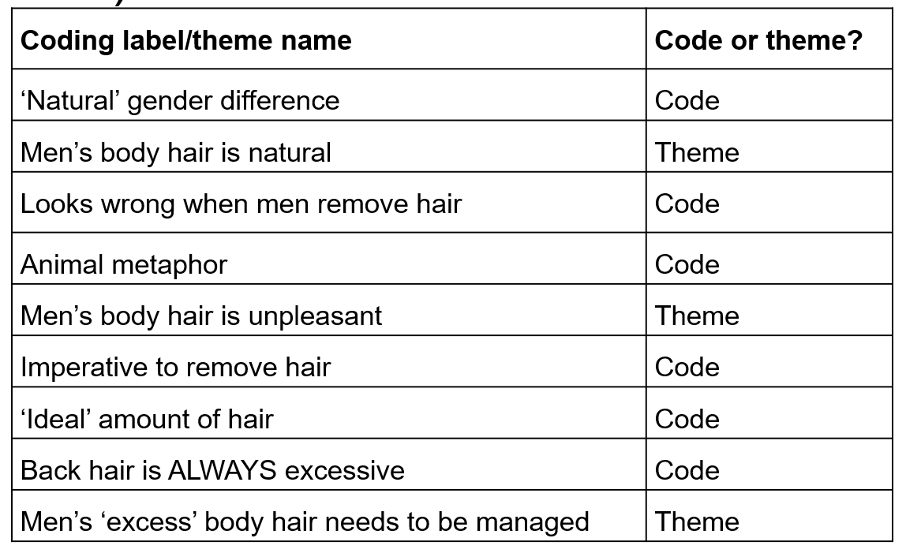

# Research skills sessions {#research_skills_sessions}

Ashley has recorded **optional** research skills sessions on different aspects of qualitative research. These sessions take a little bit deeper dive into some of the topics and may be particularly useful if you are planning on doing a qualitative dissertation next year. Each session has its own section below, with a link to the recording and the activities that go with it.

## Preparing for data analysis {#reflexivity_skills_session}

[Watch the video here](https://echo360.org.uk/media/d4df06eb-4cf1-4ae0-bf8b-cf280d9da7e0/public){target="_blank"}

### Thinking about reflexivity {#skills_data_analysis_reflexivity}

We ask you to think about your own position in the research as part of your RM2 report (there is a section in the methods!).

This can be quite tricky to do, but is very important for qualitative research. Some suggestions to get you started:

  * Think about the topic you are doing for your research and your position in it. Where would you place yourself in relation to it? What are your own views on the topic? Do you feel quite strongly about it or not?
  * Write as you reflect. Writing – be it using pen or pencil on paper, typing on a keyboard, dictating to some voice capture device, or some other mode – is an important tool for developing reflexive depth. It is good to do this at various stages of the research process.
  * Start with your own experiences, understandings and views, but then also try to interrogate those (i.e. why do you have these particular understandings, views etc.?)

Some questions that you might ask yourself:

  * What do I expect to come up in the data? How does this relate to what we found?
  * What broader experiences have I had that might influence how I'm thinking about this?
  * What are my values (i.e. what is important to me)? What about my beliefs? How might these have influenced my thinking?
  * How might all of these be connected to my identities and the communities I am a part of?
  
### Activity 1: Read this extract and take familiarisation notes

Read this extract and take some familiarisation notes for yourself (these are just for you and won't be shared). We will then go through what Braun & Clarke say about it. 

Some context:

This activity is based on a data extract from an interview study exploring LGBT students’ experiences of university life. The participant is a gay man – a mature student, who spoke English as a second language. The extract comes from early in the interview and in response to a question about whether he is ‘out’ as a gay man at university – whether he is openly gay.

In this activity (5 mins):

  * First, reflect on your assumptions and expectations about this topic, and your positioning in relation to this topic (are you an insider researcher? Outsider?).
  * Second, read the data extract and make some familiarisation notes.
  * Braun and Clarke’s familiarisation notes follow – reflect on similarities and differences in your and their analytic observations and ‘take’ on the data.

```{block, type="info"}
Andreas: ...I sometimes try to erm not conceal it that’s not the right word but erm let’s say I’m in a in a seminar and somebody- a a man says to me ‘oh look at her’ (Int: mm) I’m not going ‘oh actually I’m gay’ (Int: mm [laughter]) I’ll just go like ‘oh yeah’ (Int: mmhm) you know I won’t fall into the other one and say ‘oh yeah’ (Int: yep) ‘she looks really brilliant’ (Int: yep) but I sorta then and after them you hate myself for it because I I don’t know how this person would react because that person might then either not talk to me anymore or erm might sort of yeah (Int: yep) or next time we met not not sit next to me or that sort of thing (Int: yep) so I think these this back to this question are you out yes but I think wherever you go you always have to start afresh (Int: yep) this sort of li- lifelong process of being courageous in a way or not …
```

::: {.callout-caution icon=false collapse="true"}
## Show me Braun & Clarke's familiarisation notes

  * Andreas reports a common experience of presumed heterosexuality: coming out is not an obvious option.
  * Social norms dictate a certain response; the presumption of heterosexuality appears dilemmatic, and he colludes in the presumption, but minimally (to avoid social awkwardness).

Looking a bit more deeply, Braun and Clarke speculated that Andreas values honesty and being true to yourself, but he recognises a socio-political context in which that is constrained, and walks a ‘tightrope’ trying to balance his values and the expectations of the context.
:::

### Activity 2: A code or a theme?

In this activity, we'll [go through a handout that asks you whether something is a code or a theme](https://gla-my.sharepoint.com/:w:/g/personal/ashley_robertson_glasgow_ac_uk/IQDIcjLZv6D8SY3X_O5C76cjAd58sZ0qH-aBD_tAPj4ZxBo?e=9Yr0gF){target="_blank"}.

For each label, decide whether it is a code or a theme.

  * Keep in mind that although there is no absolute distinction between codes and themes, codes tend to have a single facet and capture one insight or observation about the data, whereas themes are ideally multifaceted and capture several insights and observations. Themes should also capture a pattern of shared meaning – this can be shared meaning on the data surface, or shared implicit or underlying meaning. 
  * Reflect on why you have decided that each code/theme is a code or theme. What features of the data, the label/name, and brief explanation of the scope and focus of each code/theme influenced your judgement?
  

::: {.callout-caution icon=false collapse="true"}

## Show me Braun & Clarke's solution

```{r img-themeorcode, echo=FALSE, fig.cap="Braun and Clarke's suggestions"}

```

Three themes were presented in the analysis: "Two themes capture contradictory ideas: that men’s body hair is natural, and that men’s body hair is unpleasant. A third theme introduces the concept of ‘excess’ hair, which allowed sense-making of this contradiction, mandating men’s grooming of ‘excessive’ hair." (Terry & Braun, 2016, page 14)

:::


### Some common problems with thematic analysis {#skills_data_analysis_common_problems}

  * Thematic analysis that fails to address the research question.
  * Unconvincing or under-developed analysis: 1) Too many or too few themes 2) Too much overlap between themes or themes are unrelated 3) Themes are vague or not internally consistent or coherent
  * Little or no analytic work has been carried out (for example, using data collection questions as ‘themes’).
  * Topic summaries being presented as themes
  * Mismatch between data and analytic claims (e.g. going beyond what your participants say)
  * Too few or too many data extracts (and little or no analytic commentary).
  * Paraphrasing rather than analysing and interpreting data
  * Arguing with the data – pointing out the ‘errors’ in a participant’s account.

### Strategies for ensuring quality in your analysis

**Reflexive journalling**

Keep reflecting, and writing, throughout the whole research process, not just at the end (see [Thinking about reflexivity](#skills_data_analysis_reflexivity)).
  
**Talk about your data with others**

  * Discuss your analysis with other people – it helps to clarify your analytic insights
  * Do phases 1-2 in pairs if you want
  * Discuss your findings in groups
  * Come along to office hours
  * Present your analysis (even if it's preliminary), this can help solidify where we are going with it

**Give yourself time**

  * Try not to leave the analysis until the last minute
  * Give yourself time to step away and breathe
  * Perhaps work on other sections of your report at the same time, so that you have a mental break from analysis
  
**Make sure themes are themes (and be careful when naming them)**

Connelly and Peltzer (2016, p.55): "When a researcher designated a 1-word theme, such as 'collaboration', what does that mean in relationship to the experiences of the informants as interpreted by the researcher? Using only 1 word as a theme, there is no way of knowing, for example if the experiences of collaboration were positive or negative, or whether collaboration is important to the nurses. One-word themes do not convey what the researcher found out about collaboration"
