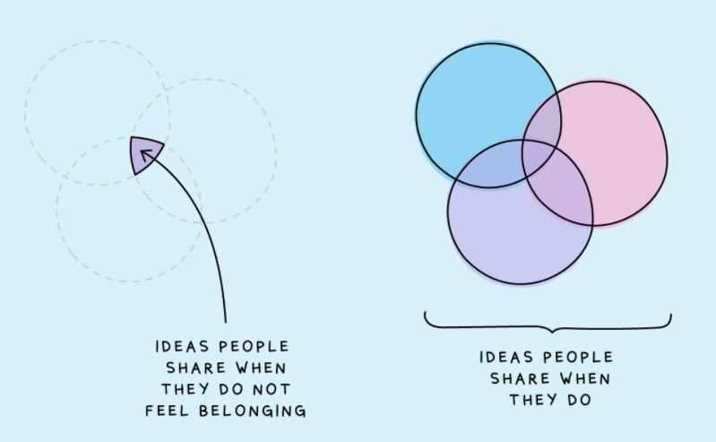
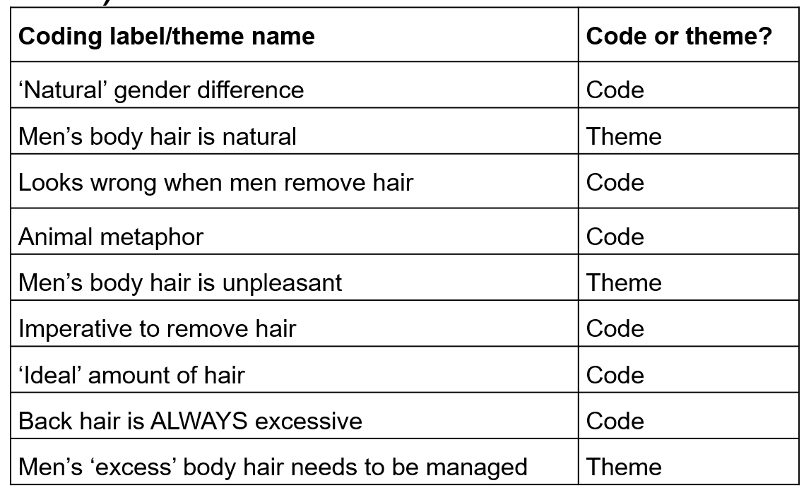

# Research skills sessions {#research_skills_sessions}

Ashley has recorded **optional** research skills sessions on different aspects of qualitative research. These sessions take a little bit deeper dive into some of the topics and may be particularly useful if you are planning on doing a qualitative dissertation next year. Each session has its own section below, with a link to the recording and the activities that go with it.


## OPTIONAL: Research skills session - Developing questions

Ashley has recorded **optional** research skills sessions on different aspects of qualitative research. These sessions take a deeper dive into some of the topics and may be particularly useful if you are planning on doing a qualitative dissertation next year. 

[Watch the video here](https://echo360.org.uk/media/56e4abb3-e58c-4560-897b-18d2eeb91833/public?autoplay=false&automute=false&startTimeMillis=0)

### Overall structure

It's important to think about the overall structure of an interview or focus group schedule. A good structure to use is: A warm up question, the main questions you want to ask, and an exit question. It is likely particularly important to use a warm up/ice-breaker question for a focus group, especially if participants don't know each other particularly well.

**Warm up Question**

The aim is to allow participants to introduce themselves, ensure everyone understands the procedure, and to encourage people to feel comfortable talking. Previous projects have used photos, cartoons, and media, or asked participants to generate meanings of the terms used in the discussion (e.g., “poor sleep”, “well-being”) to get people talking. *What is your idea for an ice-breaker that might lead naturally into the main discussion?*

*What makes a good/poor ice-breaker?*

Thinking about the points above: *What do you think of the following ice-breakers?*

  * **An FG on lived experience during COVID-19 of international students:** What is your favourite meal from your home country?
  * **An FG on coping strategies in students:** What do you think is the best way to reduce stress for students?
  * **An FG on feelings of belonging in a work context:** What do you think about the graphic below? Does it resonate in any way?
  
```{r img-belonging, echo=FALSE, fig.cap="Belonging ice-breaker"}

```

**Main Questions**

Bear in mind that the discussion may wander off track or focus on one aspect. Consider which part of the research question you think is most important to get people to answer. Start with this and be prepared to come back to it at the end if you need to. If you have more sensitive questions in your research schedule, they should be included later on, so people answer them when they are more comfortable.

**What should the questions be like?**
Avoid asking questions that ask two or three things in one sentence (e.g., about behaviour and impact on mood). Break it down into simpler questions. Limit the number of direct questions that elicit yes/no answers. These can be useful to gather information but are less helpful in generating a discussion. Add in probes/prompts to elicit
further information if required.

Try to:

1. Frame questions in an open way that will facilitate discussion (e.g. 'do you use Facebook?' is closed (can be answered as yes/no), whereas 'can you tell me about your experiences with social media?' is a bit more open - you could then follow up with prompts to specifically ask about types if you want to get that information).

2. Frame questions in a way that is not leading. For example, 'how did lockdown negatively impact on your ability to study?' assumes that it did, when this may not be the case. A better question would be "Do you think that lockdown restrictions impacted on students' experiences of studying? If so, how? If not, why not?"

3. If you have sensitive questions, try to frame questions in a way that is not personal (i.e. you give people a chance to answer related to themselves, but they can also choose not to). This approach also invites people who may not have lived experience to respond, e.g. "How do you take care of yourself when you are anxious?" would be better phrased as "How might students support themselves when they are feeling anxious?" This is more important for focus groups, as people might feel put on the spot and go beyond their comfort levels.

4. Avoid asking lots of different things within the one question, e.g. "Can you tell us about your experiences of studying in Semester 1, how it made you feel and how that affects your studying in Semester 2?" You could ask about experiences of studying generally, and then could follow up with specific sub-questions asking them about semester 1 and 2, if that is something that was important to you.

**Closing question**

The aim here is to give people an opportunity to add anything that might have been missed in the discussion/to wrap things up.

Examples:

  * Thank you very much for all the great points you had today! Before we wrap things up, do you have any final points that you would like to make, that perhaps weren't covered in the interview?
  * Today we covered X, Y, and Z in the focus group. Is there anyone who has any final thoughts about what we covered here today that they'd like to share?
  * That's us finished with the main part of the focus group. We'd like to end by giving you all an opportunity to add anything that you think is important but has not been covered in the focus group so far. If you'd like to add something, please press raise hand on Teams and we can make sure we go round those people before we finish up!
  
### Braun & Clarke (2013) activity

Here, we have an adapted version of an interview schedule that is included in the Braun & Clarke (2013) book, on the topic of Partner Relationships. This is purposefully poor. What problems can you spot?

1. If you are not already married, are you planning to get married within the next few years?
2. I love going to the cinema with my partner, do you?
3. Do you have a good time with your partner?
4. Would you go to Relate if you had problems in your
relationship?
5. When and how did you meet your partner?
6. Do you earn more money than your partner?

::: {.callout-caution icon=false collapse="true"}

## Show me the solution

*This solution is adapted from Braun & Clarke (2013).*

**In general**
Overall, the interview schedule lacks coherence – it covers a wide range of different topics, and it’s not clear what the focus of the interview is. The ordering of the questions is also very poor (very sensitive questions early in the interview; moving straight from questions about positive aspects of the relationship to relationship difficulties). The researchers should decide on the focus of their research, and their research question, and design the interview schedule with these in mind. The schedule should also be reordered so it starts with less sensitive questions (more sensitive questions should be moved to later in the interview) and the questions flow logically. The interview should also end with a general ‘clean-up’ question (e.g., ‘Is there anything else you would like to add?’). (NB. These answers assume that the research is being conducted in Britain) 


**Question 1** 

*Problems*
First, this is a closed question which does not encourage participants to provide rich and detailed answers. Second, unless the researcher already has quite a bit of information about the participant, it is not an ideal opening interview question because it makes a number of problematic and potentially alienating assumptions, which may damage rapport. For example, unless the study is specifically focused on heterosexual couples (‘partner relationships’ suggests an inclusive focus), or the researcher already knows how the participants identify their sexuality, assuming that people are married, or asking whether they are planning to marry, reinforces heteronormativity. Furthermore, unless the research is specifically focused on marriage, asking whether people are ‘planning to get married’ assumes a particular model of relationships whereby marriage (and civil partnership) is treated as the ‘gold standard’ of relationships, the ideal end-point of a couple’s relational journey, and not everyone views marriage in this way (some couples are critical of marriage and choose actively not to get married). 

*Solutions* 
The question needs to be reworded so that it is inclusive of same-sex and heterosexual relationships and does not ‘buy into’ assumptions about marriage as gold standard of relationships. The question should also be reworded as an open question and probably moved to later in the interview. 

 

**Question 2** 

*Problems*
Again, a closed question and extremely leading – it invites the participant to agree with the researcher’s preferences! This is not the best way of accessing participants’ perspectives. 

*Solutions*
Reword the question so that it is open and not leading (do not use the researcher’s preferences in this way). 

 
**Question 3**

*Problems*
Again closed, and rather vague (what constitutes a ‘good time’?). 

*Solutions* 
Reword the question so that it is open and more concrete. 

 
**Question 4**

*Problems* 
Again closed, and assumes that the participants know what Relate is (a charity in England and Wales that offers relationship counselling and sex therapy to heterosexual and same-sex couples experiencing relationship difficulties; in Scotland, similar support is provided by Relationships Scotland). Making assumptions about what the participants know (and don’t know) can alienate participants (making them feel stupid for not knowing) and damage rapport. Moreover, Relate is not the only provider of relationship counselling in the UK. 

*Solutions*
Replace this with an open question and one that does not make assumptions about the participants’ knowledge (e.g., ‘relationship counselling’ is a good substitute for Relate). 

 

**Question 5** 

*Problems* 
A double-barrelled question and also one that would work better earlier in the interview. 

*Solutions*
Reword the question to remove the double-barrelled element (decide what is more important to know when [how long ago] they met their partner or how they met them?). This would work better as the opening interview question (it makes little sense to ask questions 1-4 before asking this question) because it is a relatively ‘gentle’ question and possibly one that participants would be expecting to answer in an interview on partner relationships. It provides participants with an opportunity to ‘tell the story’ of their current relationship at the start of the interview. 


**Question 6**

*Problems* 
Again a closed question and also a very sensitive one! 

*Solutions*
Again, this needs to be replaced with a more open question that invites detailed responses. The researcher should reflect on what they want to know and how this question relates to their research question. 

 
:::


### Further things to consider with qualitative surveys

1. No opportunity for clarification, so wording has to be clear
2. Similar points to above in terms of not asking too many different things, having a sensible structure
3. No rapport, unlikely to be an 'ice-breaker' (although might have an intro question)
4. People might be more comfortable answering sensitive
questions as they can be anonymous
5. Try not to have lots of questions as your participants will likely lose patience - what are the key things you want to know?
6. Can use branching e.g. in Qualtrics


## OPTIONAL: Research skill session - data collection

Ashley has recorded **optional** research skills sessions on different aspects of qualitative research. These sessions take a little bit deeper dive into some of the topics and may be particularly useful if you are planning on doing a qualitative dissertation next year. 

[Watch the video here](https://echo360.org.uk/media/1f84181c-364e-47e3-a61e-415e4ec5a368/public?autoplay=false&automute=false&startTimeMillis=0){target="_blank"}

### General tips

  * Be organised  - get ethics in early etc., keep track of potential participants
  * Think through all the different steps involved as you will need to refer to this in your ethics application  - how do you plan to recruit, collect the data, store the data? Before you start collecting data, it would be good to have a checklist with everything you need to consider
  * Only collect the demographics that you need  - if you don't need to know how many siblings they have or what time they go to bed, then don't ask for that information
  * Be sensitive to who your participants are - you might ask different questions in a focus group (where people are in front of others) than you would in an online questionnaire (where it is easier to withdraw if uncomfortable).
  * Think about how you keep that data safe/anonymous
  * Know in advance how many participants you need
  * Know how you plan to analyse the data
  * Consider what you can do to make the experience as
comfortable as possible for participants (e.g. sending out questions in advance is particularly helpful for neurodivergent people/people who do not speak English as a first language).
  * For interviews and focus groups - reassert consent before you start & always remember to press record! Also it's normal to feel a bt nervous - try to enjoy the process!
  * For all, pilot the questions you ask - make sure that people take from them what you think
  * When recruiting, think about who your target group is and it's good to justify why you are looking for a particular demographic. For example, do you definitely require someone to have a particular diagnosis?
  
### Practicalities of running focus groups

  * Establish ground rules - esp. confidentiality
  * Set expectations - ask participants to respond to each other rather than each person individually responding to the question (if possible, this is not always the case)
  * Moderator has to manage the group as best they can
  * Wrapping things up.
  * Can be helpful to have a notetaker to note down anything interesting/if doing it in person, to note down order that people speak in. Allows the moderator to focus on discussion

**Tricky situations**

  * How do you develop rapport/make people feel more
comfortable?
  * How do you manage tricky dynamics within a group?
  * What if no-one speaks/one person dominates?
  * What if people go off topic?
  * How to keep people to time?
  * Giving everyone who wants it an opportunity to speak - if online could ask people to raise their hand
  
  
### Practicalities of running interviews

Some of the things that we discussed in focus groups are
relevant here, but specifically when thinking about interviews:

  * Try to develop rapport and make the participant feel
comfortable
  * Try to focus on the person rather than taking notes - are you giving them encouragement to keep speaking (e.g. nods etc.)?
  * If doing a semi-structured interview, try to notice if the participant brings something up that could/should be followed up with an additional question
  * It's usual for some interviews to be shorter than others - some people are very concise in how they answer whereas others talk a lot more (and this may be on topic or not)
  * Be aware of how someone is presenting - this is less relevant for coursework and more for future projects - if you are doing quite a sensitive topic, it's good practice to reassert consent and to ask people if they need a break for a little while/if they are okay to continue.
  * Try to end on a positive question if you can - it can help to lift the mood for the participant and leave them in a good place
  
### Practicalities of running qualitative surveys

  * Think about whether there would be any possibility for the questions to be misinterpreted - you won't have a chance to correct people if they interpret something wrong (this is where doing a pilot can be useful)
  * Try not to have too many questions  - what are the key things you want to know? People will be less likely to respond with long, in depth answers if there are a lot of questions to answer.
  * It might be good to give an indication of how many questions they have to go through.
  * Easier to keep data anonymous than it is with other forms of data collection above - however still be sensitive to locations, names, personal experiences as these will have to be anonymised.


## Preparing for data analysis {#reflexivity_skills_session}

[Watch the video here](https://echo360.org.uk/media/d4df06eb-4cf1-4ae0-bf8b-cf280d9da7e0/public){target="_blank"}

### Thinking about reflexivity {#skills_data_analysis_reflexivity}

We ask you to think about your own position in the research as part of your RM2 report (there is a section in the methods!).

This can be quite tricky to do, but is very important for qualitative research. Some suggestions to get you started:

  * Think about the topic you are doing for your research and your position in it. Where would you place yourself in relation to it? What are your own views on the topic? Do you feel quite strongly about it or not?
  * Write as you reflect. Writing – be it using pen or pencil on paper, typing on a keyboard, dictating to some voice capture device, or some other mode – is an important tool for developing reflexive depth. It is good to do this at various stages of the research process.
  * Start with your own experiences, understandings and views, but then also try to interrogate those (i.e. why do you have these particular understandings, views etc.?)

Some questions that you might ask yourself:

  * What do I expect to come up in the data? How does this relate to what we found?
  * What broader experiences have I had that might influence how I'm thinking about this?
  * What are my values (i.e. what is important to me)? What about my beliefs? How might these have influenced my thinking?
  * How might all of these be connected to my identities and the communities I am a part of?
  
### Activity 1: Read this extract and take familiarisation notes

Read this extract and take some familiarisation notes for yourself (these are just for you and won't be shared). We will then go through what Braun & Clarke say about it. 

Some context:

This activity is based on a data extract from an interview study exploring LGBT students’ experiences of university life. The participant is a gay man – a mature student, who spoke English as a second language. The extract comes from early in the interview and in response to a question about whether he is ‘out’ as a gay man at university – whether he is openly gay.

In this activity (5 mins):

  * First, reflect on your assumptions and expectations about this topic, and your positioning in relation to this topic (are you an insider researcher? Outsider?).
  * Second, read the data extract and make some familiarisation notes.
  * Braun and Clarke’s familiarisation notes follow – reflect on similarities and differences in your and their analytic observations and ‘take’ on the data.

```{block, type="info"}
Andreas: ...I sometimes try to erm not conceal it that’s not the right word but erm let’s say I’m in a in a seminar and somebody- a a man says to me ‘oh look at her’ (Int: mm) I’m not going ‘oh actually I’m gay’ (Int: mm [laughter]) I’ll just go like ‘oh yeah’ (Int: mmhm) you know I won’t fall into the other one and say ‘oh yeah’ (Int: yep) ‘she looks really brilliant’ (Int: yep) but I sorta then and after them you hate myself for it because I I don’t know how this person would react because that person might then either not talk to me anymore or erm might sort of yeah (Int: yep) or next time we met not not sit next to me or that sort of thing (Int: yep) so I think these this back to this question are you out yes but I think wherever you go you always have to start afresh (Int: yep) this sort of li- lifelong process of being courageous in a way or not …
```

::: {.callout-caution icon=false collapse="true"}
## Show me Braun & Clarke's familiarisation notes

  * Andreas reports a common experience of presumed heterosexuality: coming out is not an obvious option.
  * Social norms dictate a certain response; the presumption of heterosexuality appears dilemmatic, and he colludes in the presumption, but minimally (to avoid social awkwardness).

Looking a bit more deeply, Braun and Clarke speculated that Andreas values honesty and being true to yourself, but he recognises a socio-political context in which that is constrained, and walks a ‘tightrope’ trying to balance his values and the expectations of the context.
:::

### Activity 2: A code or a theme?

In this activity, we'll [go through a handout that asks you whether something is a code or a theme](https://gla-my.sharepoint.com/:w:/g/personal/ashley_robertson_glasgow_ac_uk/IQDIcjLZv6D8SY3X_O5C76cjAd58sZ0qH-aBD_tAPj4ZxBo?e=9Yr0gF){target="_blank"}.

For each label, decide whether it is a code or a theme.

  * Keep in mind that although there is no absolute distinction between codes and themes, codes tend to have a single facet and capture one insight or observation about the data, whereas themes are ideally multifaceted and capture several insights and observations. Themes should also capture a pattern of shared meaning – this can be shared meaning on the data surface, or shared implicit or underlying meaning. 
  * Reflect on why you have decided that each code/theme is a code or theme. What features of the data, the label/name, and brief explanation of the scope and focus of each code/theme influenced your judgement?
  

::: {.callout-caution icon=false collapse="true"}

## Show me Braun & Clarke's solution

```{r img-themeorcode, echo=FALSE, fig.cap="Braun and Clarke's suggestions"}

```

Three themes were presented in the analysis: "Two themes capture contradictory ideas: that men’s body hair is natural, and that men’s body hair is unpleasant. A third theme introduces the concept of ‘excess’ hair, which allowed sense-making of this contradiction, mandating men’s grooming of ‘excessive’ hair." (Terry & Braun, 2016, page 14)

:::


### Some common problems with thematic analysis {#skills_data_analysis_common_problems}

  * Thematic analysis that fails to address the research question.
  * Unconvincing or under-developed analysis: 1) Too many or too few themes 2) Too much overlap between themes or themes are unrelated 3) Themes are vague or not internally consistent or coherent
  * Little or no analytic work has been carried out (for example, using data collection questions as ‘themes’).
  * Topic summaries being presented as themes
  * Mismatch between data and analytic claims (e.g. going beyond what your participants say)
  * Too few or too many data extracts (and little or no analytic commentary).
  * Paraphrasing rather than analysing and interpreting data
  * Arguing with the data – pointing out the ‘errors’ in a participant’s account.

### Strategies for ensuring quality in your analysis

**Reflexive journalling**

Keep reflecting, and writing, throughout the whole research process, not just at the end (see [Thinking about reflexivity](#skills_data_analysis_reflexivity)).
  
**Talk about your data with others**

  * Discuss your analysis with other people – it helps to clarify your analytic insights
  * Do phases 1-2 in pairs if you want
  * Discuss your findings in groups
  * Come along to office hours
  * Present your analysis (even if it's preliminary), this can help solidify where we are going with it

**Give yourself time**

  * Try not to leave the analysis until the last minute
  * Give yourself time to step away and breathe
  * Perhaps work on other sections of your report at the same time, so that you have a mental break from analysis
  
**Make sure themes are themes (and be careful when naming them)**

Connelly and Peltzer (2016, p.55): "When a researcher designated a 1-word theme, such as 'collaboration', what does that mean in relationship to the experiences of the informants as interpreted by the researcher? Using only 1 word as a theme, there is no way of knowing, for example if the experiences of collaboration were positive or negative, or whether collaboration is important to the nurses. One-word themes do not convey what the researcher found out about collaboration"
